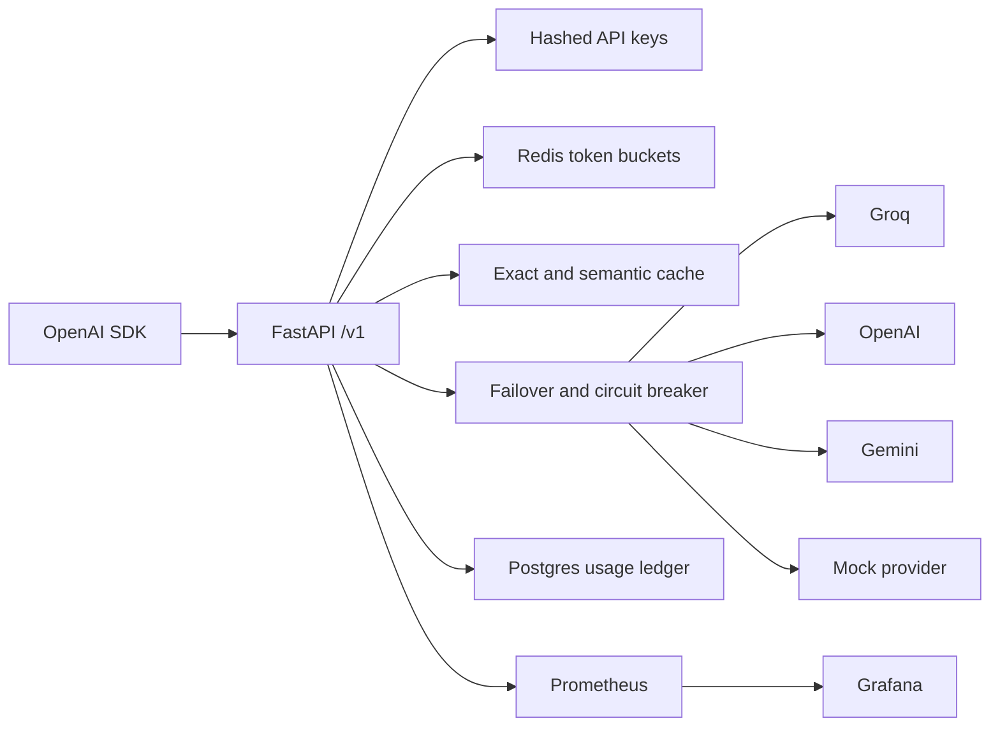

# Conduit

Conduit is a self-hosted OpenAI-compatible gateway. A client changes only `base_url`, and Conduit routes each chat completion across Groq, OpenAI, and Gemini with retries, failover, and a circuit breaker, then records tokens, cost, and latency per tenant. It is a backend and infrastructure project: there is no agent runtime and no prompt firewall here. Those belong in a caller such as [Sentinel](https://github.com/i-tomar/Sentinel), which can later point its existing OpenAI-compatible Groq client at Conduit without a code change.

## Architecture



One request does a short list of things, in order: authenticate the gateway key, replay an idempotent success if the client retried, take a request from the per-key token bucket, look up the cache, reserve budget, call the first healthy provider, and reconcile the reservation to the measured usage. Timeouts, HTTP 429, and 5xx move to the next target in the alias. A 400 does not, because the request itself was rejected.

## Quickstart

Docker Compose brings up the gateway, Postgres, Redis, Prometheus, and Grafana:

```bash
docker compose up --build
```

The demo key and admin token below are for a machine you control. Do not expose port 8091 on a shared network with these values.

```bash
curl http://127.0.0.1:8091/health

export CONDUIT_API_KEY=cdt_live_dev_local_key
curl http://127.0.0.1:8091/v1/chat/completions \
  -H "Authorization: Bearer $CONDUIT_API_KEY" \
  -H "Content-Type: application/json" \
  -d '{"model":"mock","messages":[{"role":"user","content":"hello"}]}'
```

Any OpenAI SDK works the same way:

```python
from openai import OpenAI

client = OpenAI(base_url="http://127.0.0.1:8091/v1", api_key="cdt_live_dev_local_key")
response = client.chat.completions.create(
    model="mock",
    messages=[{"role": "user", "content": "hello"}],
)
```

| Surface | URL |
| --- | --- |
| Gateway | http://127.0.0.1:8091 |
| Admin UI | http://127.0.0.1:8091/admin |
| OpenAPI | http://127.0.0.1:8091/docs |
| Prometheus | http://127.0.0.1:9095 |
| Grafana | http://127.0.0.1:3001 (admin / conduit) |

Grafana loads the Conduit dashboard from `deploy/grafana/dashboards/conduit.json`.

Without Docker, from a checkout with [uv](https://docs.astral.sh/uv/) installed:

```bash
uv sync --all-groups
make run
```

`make run` uses in-memory Redis (`fakeredis`) and SQLite, and turns fault injection on so you can drill failover locally. `make test` does not need API keys, Redis, or Postgres.

Create a real tenant key against a running gateway:

```bash
export CONDUIT_URL=http://127.0.0.1:8091
export CONDUIT_ADMIN_TOKEN=dev-admin-token
uv run conduit keys create --name lab --rpm 60 --tpm 60000
uv run conduit usage --limit 20
```

The raw key is printed once. The database stores only a peppered SHA-256 hash and a short prefix.

## Configuration

Routes, prices, retries, the circuit breaker, and cache policy live in `config/gateway.yaml`. Process settings come from the environment (`CONDUIT_*`). Copy `.env.example` and replace the pepper before anything but local use.

Aliases are ordered target lists. `fast` tries Groq, then Gemini, then OpenAI. `smart` starts at OpenAI. `mock` stays on the offline provider so the stack runs with no keys. A provider with an empty API key is skipped and does not trip the breaker. `fast` does not fall through to the mock; a missing key there is a 503, not a silent fake answer.

Prices in the YAML file are sample list rates for local cost estimates. They are not invoices. Replace them with the rates on your contract. Costs are stored as integer microdollars.

| Variable | Role |
| --- | --- |
| `CONDUIT_DATABASE_URL` | `postgresql+asyncpg://...` or `sqlite+aiosqlite:///./conduit.db` |
| `CONDUIT_REDIS_URL` | Redis URL, or `memory://` for fakeredis |
| `CONDUIT_ADMIN_TOKEN` | Required for `/admin` and the CLI |
| `CONDUIT_DEV_API_KEY` | Optional key seeded on startup, prefix `cdt_` |
| `CONDUIT_KEY_PEPPER` | Mixed into the key hash |
| `CONDUIT_SEMANTIC_CACHE` | Overrides the YAML flag |
| `CONDUIT_ALLOW_FAULT_INJECTION` | Honors `X-Conduit-Fault` |
| `CONDUIT_OTLP_ENDPOINT` | OTLP/HTTP traces. Empty means spans are created and not exported |
| `GROQ_API_KEY`, `OPENAI_API_KEY`, `GEMINI_API_KEY` | Upstream credentials |

Cache scope defaults to `tenant`, so two API keys do not share answers. Set `cache.scope: global` when identical prompts are not confidential and you want a higher hit rate. Tool calls are not cached. `X-Conduit-Cache: bypass` skips both caches.

`X-Conduit-Fault: primary=429` is a drill header. It is ignored unless fault injection is enabled. Supported faults: `timeout`, `429`, `500`, `400`, `malformed`, `malformed_mid`, `slow`.

Streaming is server-sent events. If the upstream fails before the first token, Conduit fails over. If it fails after a token has been sent, the stream ends with an error event and the backup is not called, because the client has already seen a partial answer.

## Features

- `POST /v1/chat/completions` and `GET /v1/models`, streaming and non-streaming, so an OpenAI SDK only changes `base_url`.
- Adapters for Groq, OpenAI, and Gemini's OpenAI-compatible endpoint, plus a deterministic mock provider.
- Configured aliases, retries with exponential backoff, failover on timeout / 429 / 5xx, and a per-process circuit breaker.
- Exact-match Redis cache and an optional semantic cache. The semantic cache uses a local feature hash so it runs offline. It is a recall aid, not a hosted embedding model.
- Gateway API keys hashed at rest, per-key request and token buckets, and hard token and cost budgets.
- Usage rows for tenant, model, provider, tokens, cost, latency, time to first token, cache result, and failover attempts. `Idempotency-Key` stores one success and does not charge the retry.
- Prometheus metrics and an OpenTelemetry tracer, with a provisioned Grafana dashboard.
- Admin UI and CLI to create keys and read usage.

Rate-limit failures close the gate: if Redis cannot answer the bucket, the request is rejected. Cache failures open the gate: a Redis cache error is a miss, not an outage. Prompts and API keys are not written to logs or to the usage table. A log line records token counts and a redacted key prefix.

Budgets reserve the prompt estimate plus `max_tokens` before the upstream call, then reconcile to the provider's usage. If `max_tokens` is omitted, the completion is charged after the fact and one response can cross the cap. Set `max_tokens` when the cap must hold before the call. Cache hits count against the token budget and the token bucket, and they cost zero because nothing was sent upstream.

## Benchmark

These figures are the output of `make bench` (`scripts/benchmark.py`) on this machine. They are mock-provider results: in-memory Redis, SQLite, a single process, and loopback HTTP. They are not Groq, OpenAI, or Gemini latency. The raw report is `benchmarks/latest.json`.

Measured on Linux 6.12, x86_64, 4 CPUs, Python 3.12.3. Serial runs are 120 requests at concurrency 1. Loaded runs are 240 requests at concurrency 20. Error count was 0.

| Measurement | Result |
| --- | --- |
| Direct mock function, p95 | 0.0016 ms |
| `GET /health`, serial p95 | 4.58 ms |
| Gateway cache miss, serial p50 / p95 / p99 | 15.17 / 16.84 / 18.51 ms |
| Gateway cache hit, serial p50 / p95 / p99 | 13.73 / 15.94 / 17.28 ms |
| Gateway overhead, serial p95 (miss minus direct mock) | 16.84 ms |
| Cache-hit savings, serial p95 | 0.90 ms (5.4%) |
| Streaming time to first event, serial p50 / p95 | 11.41 / 12.59 ms |
| Throughput, concurrency 20, cache miss | 81.0 req/s |
| Throughput, concurrency 20, cache hit | 84.9 req/s |

The overhead number is serial on purpose. At concurrency 20 the miss p95 was 909 ms and the mean was 239 ms. That tail is queueing behind SQLite writes and the per-key Redis lock, not 909 ms of proxy work. The serial p95 of 16.8 ms is the gateway's added latency against an instant mock.

Cache savings are small for the same reason: the mock returns immediately, and a hit still authenticates, takes rate-limit tokens, and writes a usage row. The hit avoids the provider call and the budget reservation. Against a real provider, the saved time is mostly the upstream call, which this run does not measure.

Load the same mock path with Locust:

```bash
CONDUIT_API_KEY=cdt_live_dev_local_key \
  uv run locust -f load/locustfile.py --host http://127.0.0.1:8091
```

## Design decisions

- Groq, OpenAI, and Gemini share one OpenAI-compatible adapter. A provider that speaks a different schema would get its own adapter behind the same `complete` / `stream` interface.
- Failover is an ordered list, not a latency race. The order is visible in config and in the `X-Conduit-Attempt-Statuses` header.
- The circuit breaker lives in the process. Each replica learns outages on its own. A Redis-backed breaker is the multi-replica version of the same state machine and is not built yet.
- The token bucket is a Redis read-modify-write under a short `SET NX` lock. A Lua script would be one round trip; the lock keeps the offline fakeredis tests on the same code as production Redis, which does not require a script engine in the test double.
- Semantic cache embeddings are a hashed bag of tokens. Swap `embed()` for a real embedding model when you want paraphrase recall. The threshold defaults to 0.92 so a weak hash does not return loose matches.
- Money is integer microdollars. Token estimates are about four characters per token and are replaced by provider usage when the upstream response includes it.
- Idempotency stores the successful JSON body. A failed attempt deletes the in-progress row so the client can retry the same key. A different body with the same key is a 409.
- SQLite is the local and test database. Compose uses Postgres. Schema is created on startup. Migrations are not generated yet.

## Tests

```bash
make test
make lint
```

The suite is pytest: circuit-breaker transitions, the token bucket, cache keys, cost math, the OpenAI adapter against an httpx mock transport, routing, and API tests that drive failover, malformed streams, rate limits, budgets, and idempotency through the ASGI app. No test calls a hosted model.

CI on every push runs ruff, mypy, and pytest with a coverage floor of 85 percent.

## Roadmap

- Point Sentinel at Conduit. Sentinel already calls Groq through an OpenAI-compatible client. The integration is `base_url` plus a Conduit API key. No agent code and no prompt-injection guard moves into this repository.
- Redis-backed circuit breaker for more than one gateway replica.
- A real embedding provider, or pgvector, behind the same semantic-cache interface.
- Alembic migrations.
- Anthropic as a translating adapter rather than an OpenAI-compatible pass-through.
- Weighted or least-latency routing in addition to ordered failover.

Kubernetes sketches live in `deploy/k8s/`. They expect an image and external Postgres and Redis. Cloud Run can run the same container with `CONDUIT_DATABASE_URL` and `CONDUIT_REDIS_URL` pointed at managed services, `--port 8080`, and the provider keys in the service environment. That path has not been deployed from this repo.

## License

MIT. Copyright 2026 Ishan Singh Tomar.
